# Bombas simulated data: review (S2.5)

Artifact: https://claude.ai/artifact/Phbr6FZiXYc4FyVsrKqnP1

Simulated data, generator v2, seed 7, scale 1.0, 2024-09-28 to 2026-09-27. Every number here is from `aggregates/*.json`, `manifest.json` and `finance_inputs.json`; nothing is a Bombas result. `data.sqlite` was not in this checkout, so checks that need a row level query (returns, chargebacks, device and source funnels) use the manifest placeholders and say so. Chart sources are in `review/` (`build_review.py`, `charts.py`); the SVGs render in light and dark.

## Verdict

Verdict: the levels are right, the shapes are too clean, and one join is broken. The simulated 24 months look like a $500M sock brand in revenue, AOV, pack mix, category split, seasonality, sales channel split, acquisition mix, paid share of sales, attribution overlap, email share and refund rate. They do not look like one in five places: site traffic is 3 to 5x too high for the revenue; support tickets are 3x the placeholder; Q4 is shaped by new customers and discounts alone, so AOV falls and Meta ROAS drops while spend triples; the repeat curve dies in year 2; and growth, daily noise and the wholesale share are pinned to one number. finance_inputs.json cannot be joined to the products at all (0 of 21 SKU keys match), so margin by SKU reads unavailable everywhere until one side changes its keys.

Screens can be built on this data now. The five shape fixes and the key fix are listed at the end as 14 numbered generator changes with the parameter to touch. None needs a paid call.

| Check | Result | One line |
|---|---|---|
| 1. Revenue and seasonality | pass | in band, index within 0.03; growth and daily noise too smooth |
| 2. AOV and pack mix | pass | $73, 85% of revenue from multi packs; Q4 AOV should rise, not fall |
| 3. New vs repeat, cohorts | flag | 36% returning is low; Q4 peak sits on new orders; year 2 repeat at 18% of year 1 |
| 4. Channel shares | flag | site 90 / wholesale 9 / retail 1 as the brain; wholesale pinned at 9.0% monthly, DSW oversize |
| 5. Funnel | flag | CVR 1.7% is a normal rate, but 27M sessions a month is 3 to 5x real traffic |
| 6. Paid and attribution | flag | MER 4.1x, 67% of orders claimed by platforms; Q4 ROAS falls to 1.5x while spend scales |
| 7. Email | pass | Klaviyo claims 17% of orders, last click 10%; right gap and right seasonality |
| 8. Returns, chargebacks, tickets | flag | refunds 3.5% fine; tickets 103 per 1,000 (placeholder 35); chargebacks 0.4% high |
| 9. Margin by channel | fail | finance SKU keys do not join; shape by channel is right once a placeholder cost is used |
| 10. Zero vs unavailable | flag | POS reads 0 for 14 months before the store opened; marketplaces correct |
| 11. Implausible rates | flag | 10 items listed, ranked |

## 1. Revenue by month against the brain's seasonality index

Result: pass

Net sales on orders for the last 12 full months are $447.4M, plus $44.2M wholesale fixture, so $491.6M against the brain's $450M to $550M band. The month shape follows the brain index once the 29.1% growth trend is removed: the largest gap is 0.027 (December, generated a little flatter than the index).

Year on year growth is 28.4% to 29.9% in every month. That is the assumption applied backward, not a brand's history: a real 2 year series wobbles by 5 to 10 points from month to month around its trend. Screens that show growth will look synthetic until the generator adds month level noise.

Daily shape is good: Cyber Monday 2025 is 3.9x a normal November day, Black Friday 3.2x, and orders halve after the December 19 shipping cutoff. The weekday curve (Sunday high, Thursday low) is right for a sock brand. Day to day noise inside a quiet month is small (June 2026 coefficient of variation 3.7%); real daily order counts move 8 to 12%.

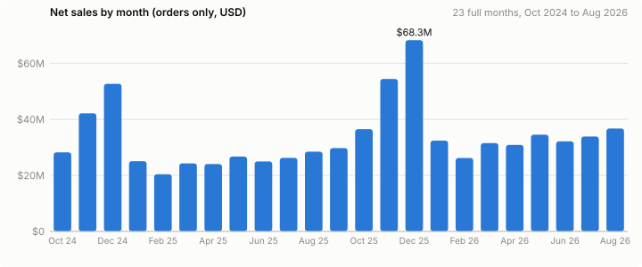

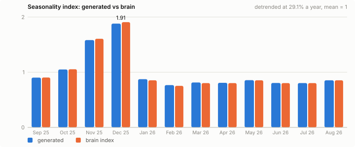

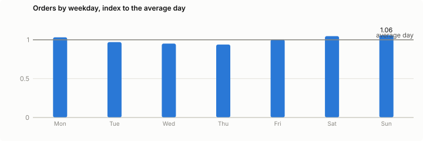

| Month | Generated index | Brain index | Gap |
|---|---:|---:|---:|
| Sep 25 | 0.903 | 0.904 | -0.001 |
| Oct 25 | 1.050 | 1.054 | -0.004 |
| Nov 25 | 1.583 | 1.607 | -0.024 |
| Dec 25 | 1.881 | 1.908 | -0.027 |
| Jan 26 | 0.874 | 0.854 | +0.020 |
| Feb 26 | 0.767 | 0.753 | +0.014 |
| Mar 26 | 0.815 | 0.803 | +0.012 |
| Apr 26 | 0.808 | 0.803 | +0.005 |
| May 26 | 0.856 | 0.854 | +0.002 |
| Jun 26 | 0.806 | 0.803 | +0.003 |
| Jul 26 | 0.804 | 0.803 | +0.001 |
| Aug 26 | 0.854 | 0.854 | -0.000 |

| Day | Orders | x normal Nov day | Discount % of gross | AOV | New share |
|---|---:|---:|---:|---:|---:|
| 2025-11-27 | 21,359 | 1.0x | 8.2% | $71.83 | 74% |
| 2025-11-28 | 68,979 | 3.2x | 10.1% | $71.22 | 92% |
| 2025-11-29 | 46,594 | 2.1x | 9.6% | $71.21 | 88% |
| 2025-11-30 | 44,894 | 2.1x | 9.6% | $71.43 | 87% |
| 2025-12-01 | 83,515 | 3.9x | 10.2% | $70.77 | 93% |
| 2025-12-02 | 38,672 | 1.8x | 9.4% | $71.64 | 85% |

## 2. AOV and pack mix

Result: pass

AOV is $73.05 on the year against the brain's $73 estimate, with 1.68 units per order (about 1.42 lines: multi packs count as 1 unit each). Multi packs carry 85% of revenue and 69% of units, which fits a brand whose whole page pushes 4 and 6 packs. Category split is socks 39552827400.0%, slippers 2048805000.0%, underwear 2703236880.0%, tees 432962950.0%: 93 / 7 as the brain says. Top SKUs by revenue: BB-ANK-4 17%, BB-CLF-4 12%, BB-ANK-6 10%, BB-QTR-4 10%, BB-GFT-8 7%.

One shape is wrong: AOV falls in November and December ($71.95) and peaks in January and February ($74.55). The generator drives this with the discount rate (8.7% of gross in Q4, 5.3% in February). A gifting brand usually sees the opposite: gift packs, bulk gifting and the free shipping line lift Q4 baskets even after deeper discounts. The Q4 AOV should be flat to up 3 to 5%, and BFCM discounts should be deeper than 10.1% of gross (Bombas runs 20% or more sitewide on those days).

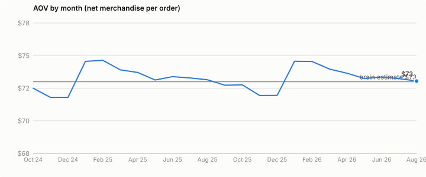

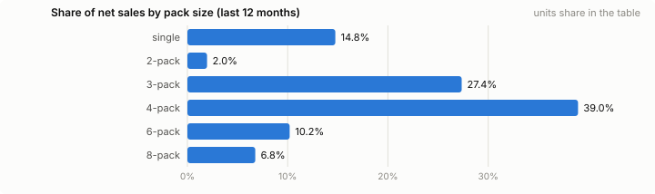

| Pack | Units share | Revenue share | Avg net price |
|---|---:|---:|---:|
| single | 31.3% | 14.8% | $20.53 |
| 2-pack | 1.5% | 2.0% | $55.64 |
| 3-pack | 24.1% | 27.4% | $49.46 |
| 4-pack | 33.8% | 39.0% | $50.23 |
| 6-pack | 6.1% | 10.2% | $72.30 |
| 8-pack | 3.1% | 6.8% | $96.37 |

## 3. New versus repeat share and the repeat curve by cohort

Result: flag

New customers place 63.7% of orders on the year and the 12 month repeat rate is 35% as calibrated. The direction by channel is right (paid social 79% new, email 20% new). Two things do not look like a 13 year old sock brand.

First, the month swing. New share runs from 43% in February to 78% in December, and on Cyber Monday 93%. Seasonality is applied to new orders almost alone: returning orders rise only 45% from August to December while new orders rise 202%. Loyal customers gift too, so returning orders should carry most of the same peak. A returning share of about 36% on the year is also at the low end for a mature replenishment brand; 40 to 50% is more typical.

Second, the curve. Every cohort has the same shape, which is fine for a simulation, but it decays too fast: the October 2024 cohort places 0.50 repeat orders per customer in year 1 and only 0.09 in year 2 (18% of year 1). For socks, year 2 is usually 40 to 60% of year 1 because a customer who has bought twice keeps buying. The fixed repeat_continue of 0.45 after every order is the cause. Holiday cohorts (gift buyers) should also repeat a little less than spring cohorts; here Nov and Dec 2024 match June 2025 exactly.

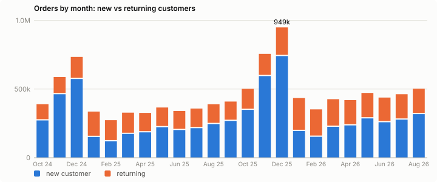

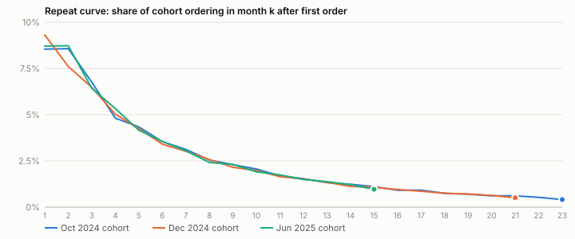

| Cohort | Customers | Month 1 | Month 2 | Month 6 | Month 12 | Orders / cust yr 1 | Orders / cust yr 2 |
|---|---:|---:|---:|---:|---:|---:|---:|
| 2024-10 | 271,684 | 8.5% | 8.6% | 3.5% | 1.5% | 0.50 | 0.09 |
| 2024-12 | 573,626 | 9.3% | 7.6% | 3.4% | 1.5% | 0.49 | 0.08 |
| 2025-03 | 173,482 | 8.5% | 8.7% | 3.4% | 1.6% | 0.50 | 0.06 |
| 2025-06 | 202,017 | 8.7% | 8.7% | 3.6% | 1.5% | 0.50 | 0.04 |
| 2025-09 | 268,016 | 8.8% | 8.4% | 3.7% | 1.4% | 0.50 | n/a |

## 4. Channel shares against the brain's channel mix

Result: flag

Sales channels land on the brain: site 90.0%, wholesale 9.0%, owned retail 1.0% (from November 2025), marketplaces unavailable as the brain's share is null. The wholesale fixture is exactly 9.0% of orders revenue in every one of the 25 months. Sell in to Nordstrom, Target and DSW does not track site orders day for day: it peaks in August to October as retailers stock for holiday and drops in January. The fixture needs its own month curve. Partner split also reads odd: DSW takes 50% of wholesale in its first year, above Athleta (22%) which has 190 doors since 2020. A first year rollout should ramp.

Acquisition mix matches the generic fallback (the brain has no acquisition split): paid social 35.0%, paid search 20.0%, organic 15.0%, direct 15.0%, email and SMS 10.0%. The Q4 tilt toward paid (paid social 38% of orders in December, 30% in February) is the right direction. AOV by channel is flat within $5, which is plausible; email and direct a little higher is correct.

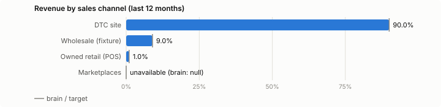

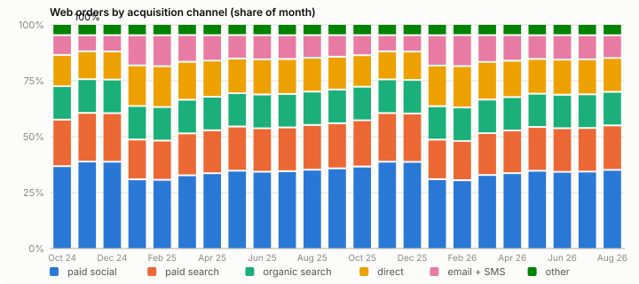

| Sales channel | Share of revenue | Brain |
|---|---:|---:|
| DTC site | 90.0% | 90% |
| Wholesale (fixture) | 9.0% | 9% |
| Owned retail (POS) | 1.0% | 1% |
| Marketplaces | unavailable | null |

| Partner | Wholesale net sales (12m) | Share |
|---|---:|---:|
| DSW | $22.1M | 50% |
| Athleta | $9.9M | 22% |
| Dick's Sporting Goods | $3.2M | 7% |
| Scheels | $3.2M | 7% |
| Nordstrom | $3.1M | 7% |
| Target | $2.7M | 6% |

| Acquisition channel | Share of web orders | Fallback | AOV | New share |
|---|---:|---:|---:|---:|
| paid social | 35.0% | 35% | $71.83 | 79% |
| paid search | 20.0% | 20% | $71.86 | 77% |
| organic search | 15.0% | 15% | $72.99 | 64% |
| direct | 15.0% | 15% | $74.94 | 38% |
| email + SMS | 10.0% | 10% | $76.40 | 20% |
| other | 5.0% | 5% | $72.91 | 64% |

## 5. Funnel rates by device and source

Result: flag

Blended conversion is 1.72% of sessions (GA4 captures a fixed 93% of web orders, so 1.85% on orders). The seasonal shape is right: conversion is lowest in November and December when traffic is cold and highest in January and February when the visitors are returning buyers. The device and source split are not in the aggregates and data.sqlite is not in this checkout, so the table below shows what the placeholders imply. Mobile at 70% of sessions converting near 1.5% and desktop near 2.5% is a normal DTC apparel shape.

The level is the problem: 328,490,919 sessions in 12 months is 27,374,243 a month. Public traffic estimators put bombas.com in the single digit millions of visits a month, so the simulated site has 3 to 5 times the traffic a reader will expect, because the revenue is sourced and the conversion rate is a placeholder. Either the brain needs a traffic anchor or the channel conversion rates need to roughly double (blended near 3%). This matters for every screen that shows sessions or cost per session.

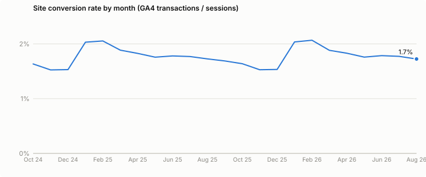

| Device | Share of sessions | CVR multiplier | Implied CVR |
|---|---:|---:|---:|
| mobile | 70% | 0.85x | 1.44% |
| desktop | 26% | 1.45x | 2.46% |
| tablet | 4% | 1.00x | 1.70% |

| Source (placeholder CVR) | CVR |
|---|---:|
| paid_social | 1.1% |
| paid_search | 3.4% |
| organic_search | 2.8% |
| direct | 4.1% |
| email | 3.8% |
| sms | 4.5% |
| other | 1.6% |

## 6. Meta and Google spend, ROAS, CPA and attribution overlap

Result: flag

Paid is $108.6M on the year (24% of net sales, MER 4.1x against the finance target of 4.0x). Meta is 71% of it. Meta CPA is $41 on the year and Google $27, and the platforms credit themselves with 67% of Shopify orders between Meta, Google and Klaviyo. That is a good, reconcilable gap for the measurement screen: no platform matches orders, the three overlap, and the total stays under 100%.

The Q4 shape is wrong. Meta spend rises 2.6x from September to December while its CPA jumps from $38 to $49 and the proxy ROAS falls from 1.9x to 1.5x. No brand scales into a falling ROAS for two months; in Q4 a gifting brand's CPM rises but conversion rises more, so CPA holds or improves. The 1.25 Q4 CPA multiplier should be near 1.05 to 1.10, and the Q4 AOV should rise (section 2) so ROAS holds around 2x. Outside Q4 the level is plausible for a brand buying mostly new customers at a $71 first order: paid social is roughly break even on the first order and earns on the repeat (section 9).

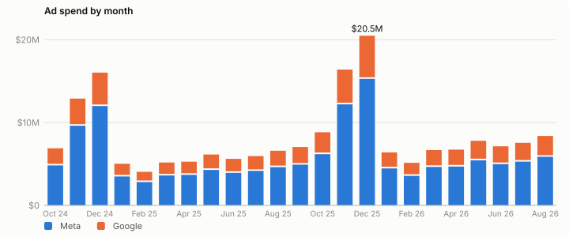

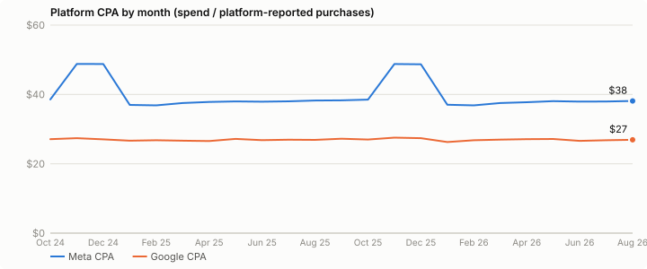

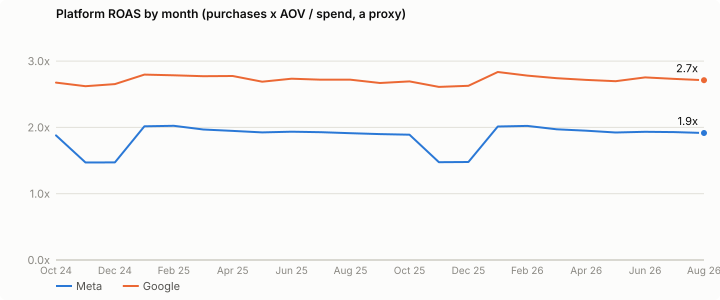

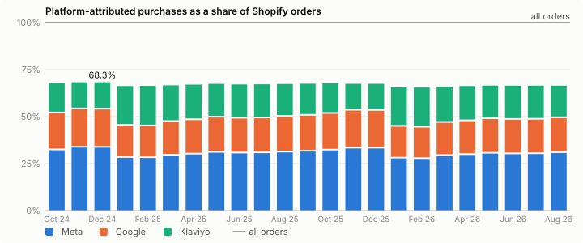

| Month | Meta spend | Meta CPA | Meta ROAS | Google spend | Google CPA | Google ROAS | Attributed / orders |
|---|---:|---:|---:|---:|---:|---:|---:|
| Sep 25 | $4.9M | $38.3 | 1.90x | $2.1M | $27.2 | 2.67x | 67% |
| Oct 25 | $6.2M | $38.5 | 1.89x | $2.6M | $27.0 | 2.69x | 68% |
| Nov 25 | $12.2M | $48.8 | 1.47x | $4.2M | $27.5 | 2.61x | 67% |
| Dec 25 | $15.3M | $48.7 | 1.48x | $5.2M | $27.4 | 2.63x | 67% |
| Jan 26 | $4.5M | $37.0 | 2.01x | $1.9M | $26.3 | 2.84x | 65% |
| Feb 26 | $3.6M | $36.9 | 2.02x | $1.6M | $26.8 | 2.78x | 65% |
| May 26 | $5.4M | $38.1 | 1.92x | $2.4M | $27.2 | 2.70x | 67% |
| Aug 26 | $5.9M | $38.1 | 1.92x | $2.5M | $26.9 | 2.71x | 66% |

## 7. Email flow revenue as a share of orders

Result: pass

Klaviyo claims 17.2% of orders on the year (flows plus campaigns, with the overlap on direct, organic and paid orders the README describes); email and SMS last click is 9.9%. The gap between the two (Klaviyo claims about 1.7x what last click gives it) is the usual real world gap. The share peaks at 21% in January and February and dips to 14% in December when paid new customers flood in: correct. The aggregates do not split flows from campaigns, so flow share alone was not checked; the flows table has 6,570 rows and campaign_sends 1,736, which is a sane ratio for 9 flows over 2 years and about 2 campaigns a day.

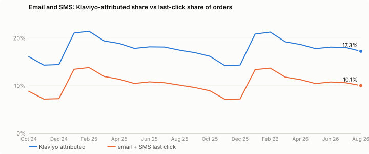

## 8. Returns, chargebacks and tickets per 1,000 orders

Result: flag

Tickets run at 103 per 1,000 orders on the year and 131 in December, against a manifest placeholder of 35 (60 in December). The fixture writes about 3x the placeholder; the README's 1,131,568 tickets on 11,061,240 orders is 10.2%. At 10% contact rate the support screen will read as a brand in trouble. Either the placeholder is not what the fixture applies or messages are being counted as tickets.

Refunds are 3.5% of net sales, consistent with a 6% return rate refunding one line, which is right for socks. The latest month shows 0.8% because returns lag the order: realistic, but the screen must label it. Chargebacks at 0.4% of orders is high: DTC apparel sits at 0.1 to 0.25%, and 0.4% approaches the level where the card networks start a monitoring program. Checkout abandonment at 0.75 abandoned checkouts per order is 43%, when 65 to 75% is the norm.

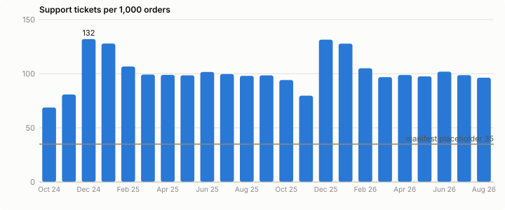

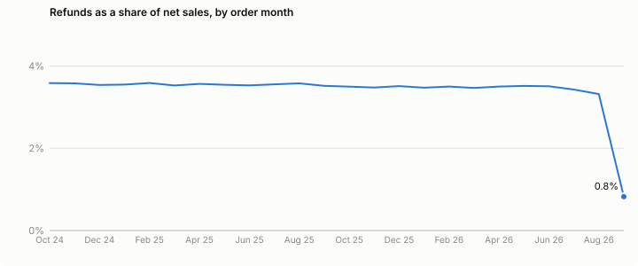

| Measure | Generated | Placeholder | Real brand range |
|---|---:|---:|---:|
| Tickets per 1,000 orders | 103 | 35 (manifest ticket_rate 0.035) | 40 to 80 for DTC apparel; 100+ reads as a support problem |
| Tickets per 1,000 orders, December | 131 | 60 (ticket_rate_dec 0.06) | 1.5x to 2x the base month |
| Return rate (orders) | not in aggregates | 6.0% (return_rate) | 3% to 8% for socks; fine |
| Refunds / net sales | 3.5% | implied by 6% returns on one line | 2% to 5%; fine |
| Chargebacks / orders | not in aggregates | 0.40% (chargeback_rate) | 0.10% to 0.25%; 0.4% is near card-network warning levels |
| Checkout abandonment | not in aggregates | 0.75 abandoned per order = 43% | 65% to 75%; low |

## 9. Margin by channel once finance inputs apply

Result: fail

finance_inputs.json cannot be joined to the data. Its 25 landed cost rows use keys like BMB-SK-M-ANK-4; the products table and products_monthly use BB-ANK-4. Overlap is 0 of 21 SKUs, so any margin screen that looks up cost by SKU reads unavailable for every line. The costs themselves are sane where a pair can be matched by eye: core packs at 26% of net price, merino and underwear at 33%, against the generator's 30% of list placeholder.

Using the placeholder cost share and the per order inputs (pick and pack $2.85 plus $0.35 a unit, packaging $0.62, USPS label about $5.30, 2.4% plus $0.30 payment fee, $4.25 a return), gross margin after fulfilment is 53% on every online channel (gross margin before fulfilment 68% versus the 62% target). After charging Meta to paid social and Google to paid search, paid social contributes 2.2% on the first order, paid search 17.5%, and owned channels around 53%. Blended contribution after all ad spend is 29%, above the 22% target, and about 15% after the $64.9M a year fixed stack (headcount, fixed costs, agency, apps, storage). This is the shape a real DTC sock brand shows: paid social near break even on first order, the business earning on repeat and owned channels. The finance rows start 2025-01-01 while the data starts 2024-09-28, so the first 3 months must read unavailable.

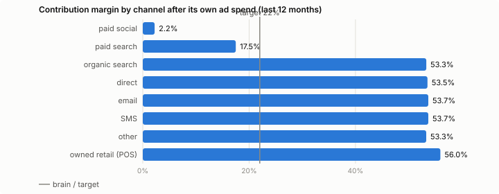

| Finance key | Product SKU | Landed cost | Net price | Cost share |
|---|---:|---:|---:|---:|
| BMB-SK-M-ANK-4 | BB-ANK-4 | $12.53 | $48.20 | 26% |
| BMB-SK-M-ANK-1 | BB-ANK-1 | $3.35 | $12.98 | 26% |
| BMB-SK-MER-3 | BB-MER-3 | $19.33 | $58.42 | 33% |
| BMB-SK-CMP-3 | BB-CMP-3 | $17.50 | $66.75 | 26% |
| BMB-UW-M-BRF-3 | BB-BXB-3 | $20.09 | $61.20 | 33% |

| Channel | Orders | AOV | GM after fulfilment | Ad cost / order | Contribution |
|---|---:|---:|---:|---:|---:|
| paid social | 2,119,173 | $71.83 | 53.2% | $36.59 | 2.2% |
| paid search | 1,210,214 | $71.86 | 53.2% | $25.65 | 17.5% |
| organic search | 908,699 | $72.99 | 53.3% | none | 53.3% |
| direct | 911,547 | $74.94 | 53.5% | none | 53.5% |
| email | 486,996 | $76.41 | 53.7% | none | 53.7% |
| SMS | 121,391 | $76.39 | 53.7% | none | 53.7% |
| other | 303,596 | $72.91 | 53.3% | none | 53.3% |
| owned retail (POS) | 62,790 | $78.73 | 56.0% | none | 56.0% |

## 10. Zero where it should be unavailable

Result: flag

The rule is that a missing or unsupported value reads unavailable, not 0. The aggregates get marketplaces right and get POS wrong.

| Place | Reads | Should read |
|---|---|---|
| channels_monthly, channel = pos, 14 months before the store opened (Nov 2025) | 0 orders, $0 | no row, or null: the store did not exist |
| monthly.pos_orders before Nov 2025 | 0 | acceptable as 0 (orders table truly has none), but screens should say 'no stores yet' |
| marketplace_listings | 0 rows, brain share null | correct: reads unavailable |
| finance_inputs before 2025-01-01 (data starts 2024-09-28) | no rows | margin for Oct to Dec 2024 must read unavailable, not $0 cost |
| refunds for the latest order month (Sep 2026) | 0.8% vs 3.5% mature | real lag; label the last 30 to 60 days as maturing, not low |
| daily.refunds_on_orders | 8 days at 0 | fine (partial days at the window edges) |

## 11. Anything implausible

Result: flag

Rates outside what a brand of this size shows, collected from the sections above, ranked by how much a screen would mislead a reader:

Sessions of 27,374,243 a month (section 5). Tickets at 103 per 1,000 orders (section 8). Chargebacks at 0.4% (section 8). Year on year growth pinned at 29% in every month and daily noise of 3.7% (section 1). Meta scaling 2.6x into a 1.5x ROAS (section 6). AOV falling in Q4 and a 10% BFCM discount (section 2). Returning orders barely lifting in Q4 (section 3). Year 2 repeat at 18% of year 1 (section 3). Wholesale pinned at 9.0% of monthly orders with DSW half of it in year 1 (section 4). Checkout abandonment of 43% (section 8).

Things that looked odd but are fine: GA4 capture at a fixed 93% (a real tag drifts 90 to 95%, add a little noise later); giving units at 31.5M versus the brain's 33.3M a year (wholesale and retail units also donate); shipping revenue at 5.1% of net (half of orders sit under the $75 free shipping line); discounts at 7.3% of gross with 55% of first orders using the 20% code.

## Fixes for the generator

Numbered, with the parameter to change. Ordered by how much each one changes what a screen shows.

1. **Join finance inputs to products.** Use one SKU key scheme. Either the generator's `products` list adopts the finance keys (BMB-SK-M-ANK-4 and the 25 SKU list in finance_inputs.json) or finance_inputs is rewritten to the 21 BB- keys. The first is better: the finance list already splits men's and women's, which the product screen will want.
2. **Ticket rate.** `ticket_rate` 0.035 and `ticket_rate_dec` 0.06 are not what the fixture writes (it lands near 0.10 and 0.13). Find the multiplier in the tickets fixture (messages per ticket, or tickets written per order line) and make the written rate equal the placeholder. Then raise the placeholder to 0.05 base, 0.08 December, which is where a $500M apparel brand sits.
3. **Traffic level.** Add a brain field `site_sessions_monthly` (assumed, with the open question flagged) and solve `cvr_by_channel` from it, or scale all seven `cvr_by_channel` values by about 1.8 so blended conversion lands near 3% and sessions near 15M a month. Keep `cvr_device_mult` as is.
4. **Seasonality on returning orders.** Apply the month index to returning orders with a weight (new `returning_seasonality_weight` = 0.7) so December new share lands near 65 to 70% instead of 78%, and Cyber Monday near 80% instead of 93%.
5. **Repeat curve.** Replace the flat `repeat_continue` 0.45 with a schedule by order number, for example 0.45 after the 1st, 0.60 after the 2nd, 0.70 after the 3rd and later, and recalibrate `repeat_q` so the 12 month repeat stays 0.35. Year 2 orders per customer should reach 40 to 60% of year 1. Add a cohort multiplier of 0.85 on `repeat_q` for November and December first orders.
6. **Q4 paid efficiency.** `meta_q4_cpa_mult` 1.25 to 1.08. Add a Q4 AOV lift (new `q4_aov_mult` = 1.04, applied to basket size, not price) so proxy ROAS holds near 2x while spend scales.
7. **BFCM discount depth.** Add `bfcm_discount_pct` = 20 and `bfcm_code_use` = 0.85 for the 5 days from Black Friday to Cyber Monday, so discounts read 18 to 20% of gross on those days instead of 10%.
8. **Growth and daily noise.** Add `growth_noise_sigma` = 0.04 (a random walk on the monthly growth factor) and `daily_noise_cv` = 0.09 so YoY growth wobbles between about 22 and 36% and daily orders vary 8 to 10% within a month.
9. **Wholesale fixture shape.** Give `wholesale_sell_in` its own month index (Aug 1.3, Sep 1.4, Oct 1.3, Nov 0.9, Dec 0.6, Jan 0.5, rest near 0.9), keep the year total at 9% of orders revenue, and ramp new partners: DSW and Target at 25% of their run rate in the first quarter, 50% in the second, full from the third. Cap DSW at about 25% of wholesale in year 1.
10. **POS before the store opened.** Do not write `channels_monthly` rows for `pos` before `owned_retail_open` (2025-11-01), and write `monthly.pos_orders` as null before that date so the screen says no stores yet rather than 0.
11. **Chargebacks.** `chargeback_rate` 0.004 to 0.0015.
12. **Checkout abandonment.** `abandoned_per_web_order` 0.75 to 2.0, which gives a 67% abandonment rate.
13. **Finance inputs start date.** Not a generator change: either set `effective_from` on the 2025-01-01 rows to 2024-09-28 or make the margin screen read unavailable for months with no cost rows. The second is the right behaviour for a real brand, so build that and leave the data alone.
14. **GA4 capture noise.** Low priority: replace the fixed `ga4_capture` 0.93 with a daily draw between 0.91 and 0.95.

## What was not checked

- Return rate, carrier returns and chargebacks by row (need `reversed_orders`).
- Funnel by device and source by row (need `sessions`).
- Flow versus campaign split inside the Klaviyo share (need `flows` and `campaign_sends`).
- Inventory cover and payouts (out of scope for this card).

## Fixes applied (S2.3c)

Session S2.3c, 28 Sep 2026. All 14 fixes are in `app/data/generate.py` (13 is in `app/metrics.py`). Data rebuilt at scale 1.0, seed 7, 2024-09-28 to 2026-09-27, on the founder calibration in `app/brain/bombas/assumptions.json`. Still simulated; nothing here is a Bombas result. Before numbers are the S2.5 figures above; after numbers come from `aggregates/calibration.json` (`review_checks`) and row queries on `data.sqlite`.

The brain changed under this rebuild too: revenue point 457M, channel mix site 74, wholesale 12, owned stores 6, marketplaces 8 (was 90, 9, 1, null), and a paid split. Result on the last 12 months: $458.3M total (+0.28 percent on the point): orders $366.6M, wholesale fixture $55.0M, marketplace fixture $36.7M. Sales channels 73.5 / 12.0 / 6.5 / 8.0 (largest gap 0.5 points). Paid split Meta 60.0, Google 20.0, YouTube creators 8.0, TikTok 6.0, Pinterest 3.0, other 3.0 (largest gap 0.01 points) on $94.0M paid. AOV $73.01, 12 month repeat 0.349, seasonality max gap 0.075, socks bucket 93.0 percent. New pieces this needed: a `marketplace_sales` fixture (Amazon 80, TikTok Shop 20, assumed), a `paid_other_spend` fixture, and one scale on the Google CPAs (0.79) so Meta to Google lands on 60 to 20; the Meta CPA placeholder stays $34.

1. Finance join (check 9). Products now use the 25 finance keys (`BMB-SK-M-ANK-4` and the rest, men's and women's split; list prices are placeholders at 22 to 30 percent landed cost). Join: 0 of 21 before, 25 of 25 after. Gross margin by month now computes from `cogs_landed`: 74.3 percent in Jan 2025, 72.4 percent after the April 2026 duty rise; Sep to Dec 2024 read unavailable (no cost rows).
2. Ticket rate (check 8). The fixture wrote a ticket for every return on top of the rate; now `ticket_rate` is all tickets per order and 30 percent of returns open a ticket (assumed `return_ticket_share` 0.30; the rest use the returns portal). Placeholder 0.035 / 0.06 to 0.05 / 0.08. Written: 103 per 1,000 (131 in December) before, 54.3 per 1,000 on the year and 80.8 in December after (the year blends 50 and December's 80).
3. Traffic level (check 5). Added `site_sessions_monthly` = 15,000,000, marked assumed in the manifest (`ASSUMED`; the brain's open question stays). All 7 `cvr_by_channel` values are scaled by one solved factor (1.376); `cvr_device_mult` unchanged. Sessions 27.4M a month and 1.72 percent before; 15.0M a month and 2.57 percent on web orders (2.40 percent on GA4 transactions) after. 3 percent is not reachable at 15M sessions with 386k web orders a month.
4. Returning seasonality (check 3). `returning_seasonality_weight` 0.7: repeat gaps run on a clock that ticks 1 + 0.7 x (season x day shape - 1). December new share 78 to 65.7 percent; Cyber Monday 93 to 71.7 percent; returning orders rise 1.45x to 2.15x from August to December while new orders rise 3.02x to 2.69x. Returning share of orders on the year 36 to 39.6 percent.
5. Repeat curve (check 3). Continuation 0.45 after the 2nd order, 0.60 after the 3rd, 0.70 after the 4th and later (was 0.45 flat); holiday cohorts (Nov and Dec first orders) repeat at 0.85x; `repeat_q` recalibrated to 0.380 so the 12 month repeat stays 0.349 (target 0.35). October 2024 cohort, year 2 over year 1 repeat orders: 18 percent before, 28 percent after (year 2 is 90 percent observed). Still under the 40 to 60 percent band: with these values a customer's chain is short. Continuation near 0.70 / 0.80 / 0.85 would be the next lever; not changed, since the founder gave the values.
6. Q4 paid (check 6). `meta_q4_cpa_mult` 1.25 to 1.08; `q4_aov_mult` 1.04 on lines per order (1.32 to 1.37), with lines per order solved so the year AOV stays $73. Meta Sep to Dec: CPA $38.3 to $48.7 and ROAS 1.90x to 1.48x before; CPA $38.1 to $41.6 and ROAS 2.08x to 1.95x after, spend 2.5x. AOV Nov and Dec $71.95 vs Jan and Feb $74.55 before; $74.28 vs $73.06 after (+1.7 percent).
7. BFCM depth (check 2). `bfcm_discount_pct` 20, `bfcm_code_use` 0.85, Black Friday to Cyber Monday (4 days, both inclusive; REVIEW said 5, the founder brief says Black Friday to Cyber Monday). Discount 10.1 percent of gross before; 17.0 percent on web orders and 15.6 percent on all orders (stores take no code) after.
8. Growth and daily noise (check 1). `growth_noise_sigma` 0.04 (random walk on the monthly growth factor, step 0.04 / sqrt 12, pinned at the as_of month) and `daily_noise_cv` 0.09. YoY growth 28.4 to 29.9 percent before; 25.6 to 41.7 percent after (Dec and Jan sit above the 36 percent guide: this seed's walk puts Q4 2025 about 6.5 percent over trend). Daily order CV in June 3.7 to 10.0 percent (March 9.9).
9. Wholesale shape (check 4). Month index Aug 1.3, Sep 1.4, Oct 1.3, Nov 0.9, Dec 0.6, Jan 0.5, rest 0.9 on the growth trend; year total 15 percent of orders revenue (12 percent of revenue). New partners ramp 25, 50, then 100 percent by quarter from October of their start year; DSW capped at 25 percent in its first year. Wholesale share of orders revenue pinned at 9.0 percent every month before; 4.7 (Dec) to 24.8 percent (Sep) after. DSW 50 to 22.5 percent of wholesale; Target 6.9 percent.
10. POS before the store opened (check 10). No `pos` rows in `channels_monthly` before 2025-11 (14 months of 0 before, none after; 11 months of rows from Nov 2025); `monthly.pos_orders` and `daily.pos_orders` read null for those 14 months; `orders` has 0 POS rows before 2025-11-01.
11. Chargebacks (check 8). `chargeback_rate` 0.004 to 0.0015. Written 0.12 percent of web orders (Shopify Payments orders only, returned orders excluded); before, the 0.40 percent placeholder applied the same way (S2.5 had no row store to measure it).
12. Checkout abandonment (check 8). `abandoned_per_web_order` 0.75 to 2.0. Abandonment 43 to 66.7 percent.
13. Finance start date (checks 9 and 10). Data left alone. `gross_margin`, `gross_profit_per_order` and every metric built on them (contribution, break even ROAS, payback, operating margin, runway) now read unavailable, never 0, when a month in the window has no `cogs_landed` row in force, and name the months (`months_without_costs`) with a `by_month` list; `gross_margin` also returns `by_month` when costs are in force. Tests in `tests/test_app_metrics.py`.
14. GA4 capture (check 11). Fixed 0.93 to a daily draw between 0.91 and 0.95 (generated 0.910 to 0.950); the year share stays near 0.93.

Left open: finance landed costs put gross margin near 74 percent against the finance target of 62 and the brain model of 63, so either the S2.4 costs or the placeholder list prices need a look; year 2 repeat (fix 5) is under its band; the YoY spread (fix 8) runs above 36 percent in two months on this seed. `review/build_review.py` still reads the old BB- keys and was not rerun.
